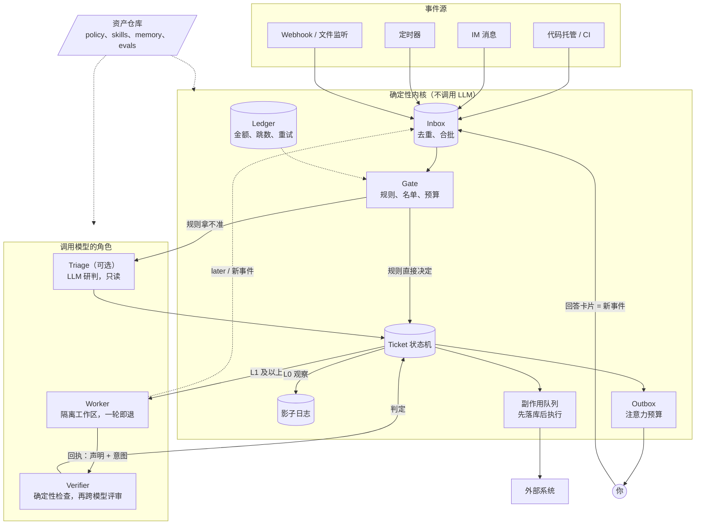

# SuperAgent 架构方案

状态：草案 v0.1，2026-11-14。依据是[调研报告](<../reports/Agent 终极形态与专属定制调研.md>)和随后给出的五条建议。文中标为"起始值"的数字都是等你用数据校准的占位，不是验证过的结论。

## 1. 定位

SuperAgent 是一个单人、本地优先的常驻 Agent 外壳。它不实现 agent 循环，循环交给现成的运行时（Claude Agent SDK、Codex CLI 等）。它只回答四个问题：

1. 什么时候叫醒 agent：事件、规则、定时器。
2. 给它多大权限：按技能分级的自主级别。
3. 它说"做完了"算不算数：独立的验证层。
4. 要不要打扰你：注意力预算。

长期积累的不是这层外壳，而是装在里面的四类文件：规则、技能、记忆、验收规范与评测集。外壳按"随时可以被平台替换"来设计，文件按"换什么外壳都带得走"来设计。

## 2. 五条建议怎样落成机制

| 建议 | 对应机制 | 章节 |
|---|---|---|
| 先做评测，再做 Agent | 每个技能自带验收规范和评测集；Verifier 独立于 Worker；没有验收规范的技能升不到 L2 | 6.1 |
| 外层写薄，资产可带走 | 确定性内核只做收件、派活、记账；资产放在独立仓库里，全部是文件；运行时走适配器 | 4、7、8 |
| 分工靠结构，失控靠硬限制 | 四个角色的能力互不重叠；预算、跳数、重试由内核代码强制 | 4、6.3、6.4 |
| 从只观察开始，按数据放权 | 四级自主阶梯，按技能设置，升级只能由人提交 | 6.2 |
| 产出 skills，不产出又一个 Agent | 技能包 = `SKILL.md` + 验收规范 + 评测集，可以单独导出 | 7 |

## 3. 不做什么

- 不自研 agent 循环、上下文压缩和工具集。
- 不微调模型。个性化放在规则、技能和记忆里。
- 不做多租户，不做 Web 界面。界面是 IM 卡片和命令行。
- 第一版不做向量检索，记忆就是文件。
- 不接技能市场。第三方技能只有人工审过、固定版本后才能入库。

## 4. 总体架构



图里的虚线表示"读取"或"回流"：资产仓库被内核和各角色读取，Worker 的 `later` 和新事件回到 Inbox。

四个角色，能力故意不重叠：

| 角色 | 用不用 LLM | 能做什么 | 不能做什么 |
|---|---|---|---|
| 内核 Kernel | 不用 | 收事件、匹配规则、派活、记账、执行副作用、发消息 | 任何判断性的决定 |
| 研判 Triage（可选） | 用，只读 | 在规则允许的技能里选一个，或判定"不值得处理" | 执行、授权、改规则 |
| 执行 Worker | 用 | 在隔离工作区里干活，交回一份结构化回执 | 直接碰外部系统、直接联系你、读写验收规范 |
| 验证 Verifier | 以确定性检查为主 | 在干净环境里判定产物是否达标 | 修改产物、执行副作用 |

这样设计的原因有两条。第一，让模型自己决定要不要分工并不可靠（DeepSeek 的实验里，中性提示下 5 次运行 0 次委派），所以分工写进结构，不写进提示词。第二，"做的人"和"判的人"分开，Worker 的"做完了"只是一个声明，只有 Verifier 的判定能让工单进入已验证状态。

Triage 默认关闭。单人场景事件量小，多数情况下规则足够决定"这类事件交给哪个技能"；只有规则无法判断时（例如"这条 IM 消息算不算一个工作请求"），才给这条规则打开 LLM 研判。

## 5. 一个事件的完整路径

1. **进件。** 事件源把事件写进 Inbox。Inbox 是唯一的事实来源，负责去重和合批。
2. **准入。** Gate 用代码检查：来源在不在名单里、匹配哪条规则、预算还剩多少、这条事件链跳了几层。任何一项不过，事件只被记录。
3. **立单。** 匹配到的规则指定技能和授权来源（mandate）：要么是某条规则，要么是你对某张卡片的回答。事件自身不能指定技能、目录、权限或预算。
4. **看级别。** 内核读取这个技能的自主级别。L0 只把"本来会怎么做"写进影子日志，流程到此结束。
5. **干活。** L1 及以上，内核为工单建一个隔离工作区，启动一轮 Worker。Worker 这一轮结束时必须交回回执：做完了、要问人、稍后再看、或失败。Worker 不等人：要问人就结束这一轮，等待期间没有进程、不花 token。
6. **验证。** 回执声称做完时，Verifier 在自己的干净环境里跑验收规范，给出 `pass`、`fail`、`error` 或 `needs_human`。
7. **副作用。** Worker 只能在回执里提出意图（开 PR、发评论、合并）。内核先把意图落库，再按自主级别决定自动执行还是发卡片请你批准。
8. **出件。** 每张工单以三种方式之一收尾：沉默、一条通知、一个问题。你的回答作为新事件回到 Inbox，续接原来的会话。

## 6. 核心机制

### 6.1 验证层

这是整套设计里最该先做、也最该做重的部分。每个技能自带一份验收规范，规定"由什么外部事实判定做完"。

```yaml
# skills/<name>/acceptance.yaml（示意）
deterministic:              # 先跑，全部通过才进入评审
  - id: tests_pass
    run: "pytest -q"
    where: clean_checkout   # 在验证器自己的干净检出上套用 Worker 的改动
  - id: scope
    diff_allow: ["src/**", "tests/**"]
    diff_deny: [".github/**", "tests/fixtures/**"]
  - id: tests_not_weakened  # 测试没有被删除或放宽
review:                     # 可选，只评确定性检查看不见的东西
  model: different_family_from_worker
  rubric:
    - "改动只解决工单描述的问题"
    - "没有把期望输出硬编码进实现"
side_effects:
  reversible: [open_pr, comment]
  irreversible: [merge, release]
```

验证层要守住的几条规矩：

- **判结果，不判叙述。** 评的是工作区最后留下的状态（测试是否通过、改了哪些文件、指标是否达到阈值），不是 Worker 的总结。
- **答案对 Worker 不可达。** 验收规范、隐藏测试和评测标签不挂载进 Worker 的工作区。这必须是结构上的隔离，在提示词里写"不要看"不算数。
- **先验证验证器。** 启用一份验收规范之前跑两次：拿一个已知正确的产物，必须通过；拿空产物或明显错误的产物，必须不通过。
- **区分"没做对"和"没跑成"。** 超时、接口报错、输出被截断记为 `error`，走有上限的重试，既不算通过也不算失败。
- **评审模型要校准。** LLM 评审用和 Worker 不同家族的模型，按可逐条检查的 rubric 打分，把被评内容当数据而不是指令。先在几十个你亲手标过的样本上看它和你的一致率，不够高就不让它参与判定。
- **误通过要回流。** 任何被你推翻的"已验证"结果记为一次误通过，自动变成该技能评测集里的新用例，并计入降级条件。

无法写出确定性检查的技能（例如"写一份有洞察的周报"）不是不能做，而是永远停在 L1，由你当最后一道验证。

### 6.2 自主级别

级别按技能设置，不是全局开关。

| 级别 | 行为 | 副作用 | 进入前提 |
|---|---|---|---|
| L0 观察 | 只记录"本来会怎么做" | 无 | 默认 |
| L1 提议 | 在工作区里做出产物，每个副作用都发卡片请你批准 | 你批准后执行 | 有验收规范；影子一致率达标 |
| L2 验证后执行 | 验证通过后自动执行可逆的副作用，不可逆的仍要批准 | 可逆的自动执行 | 容器隔离和凭据代理就位；L1 期间误通过率达标 |
| L3 执行后汇报 | 只进每日摘要 | 可逆的自动执行 | 只给几乎零风险的技能，可以永远不用 |

```yaml
# policy/autonomy.yaml（示意，数字是起始值）
skills:
  triage-failed-eval-jobs:
    level: L0
    promote_hint:                    # 满足后只提醒你，不会自动升级
      min_samples: 50
      agreement_lower_bound: 0.85    # 一致率的 95% 置信下界
    demote_when:
      consecutive_verify_failures: 2
      any_permission_violation: true
```

三条规则：

- **升级只能由人提交。** `policy/` 目录对 Worker 只读，改级别就是你在资产仓库里提交一次修改。
- **降级可以自动发生。** 连续验证失败、出现越权尝试或误通过，内核直接把该技能降一级并通知你。
- **看置信下界，不看点估计。** 通过率的噪声大约是 1/√n：25 个样本约 ±20 个百分点，100 个样本约 ±10 个百分点。所以第一个技能要挑高频任务，并且用历史案例回放来攒样本，不要只等实时事件。

### 6.3 权限：Worker 提议，内核执行

- **工作区里没有凭据。** 推送、合并、发消息这些外部动作由内核里有类型的执行器来做，Worker 只在回执里提出意图。难以撤销的动作因此都有一个可以拦截、审计的固定入口，而不是藏在一条 shell 命令里。
- **外部文字一律当数据。** 事件里的自由文本只出现在提示词的数据区，不出现在指令位置。
- **无人触发的轮次默认只读。** 只有工单带着有效授权时才给写工具。
- **出网走代理。** 从 L2 开始，Worker 必须跑在容器或系统级沙箱里，出网只经过本机代理，代理按主机名单放行，并在工作区之外注入凭据。L0 和 L1 阶段可以先不上容器，因为没有任何副作用会自动执行。

需要坦白的一点：这套做法限制的是爆炸半径，不是消灭提示注入。它的保证是"被注入的 Worker 最多弄坏自己的工作区，并提出一个会被验证层和你看到的意图"。

### 6.4 预算与硬限制

全部由内核代码强制，记在 Ledger 里，派活前检查一次，回执回来再检查一次。

| 限制 | 作用域 | 起始值 | 触发后 |
|---|---|---|---|
| 金额上限 | 每张工单、每天 | 由你定 | 工单暂停并发卡片；当天停止派活 |
| token 上限 | 每轮 | 按剩余预算换算 | 运行时收尾或被终止 |
| 跳数 | 每条事件链 | 8 | 熔断 |
| 重试 | 每张工单 | 3 | 升级给你 |
| 单轮超时 | 每轮 | 30 分钟 | 结束进程组，记为 `error` |
| 并发 | 全局 | 2 | 排队 |
| 打扰次数 | 每天 | 5 | 超出的并入摘要 |
| 总开关 | 全局 | 无 | `superagent pause` 立即停止派活 |

用量取运行时返回的真实 usage，不做估算；同时记录实际提供服务的模型，和请求的模型不一致时这一轮作废。成本按"每张已验证工单"来算，不按每次请求算。

### 6.5 注意力

- 每张工单只有三种收尾：沉默、通知、提问。默认是沉默。
- 提问做成卡片，带选项；工单进入 `waiting_human`，此时没有进程、不花 token。
- IM 里的消息保持很短，细节放在链接或文件里。其余内容并入每日摘要。
- 每条通知带一个"有用 / 没用"的一键反馈。这是调整打扰阈值的评测数据。

### 6.6 记忆

记忆就是资产仓库里的文件，只记"查不到的东西"：

- `memory/instructions.md`：你立下的长期规矩。
- `memory/notes.md`：你的角色、偏好、给过的纠正。
- `memory/decisions/`：带日期的决定记录。
- 工单内的进度笔记留在各自的工作区里，不进长期记忆。

Worker 对记忆只读。要写记忆就在回执里提出补丁，由内核作为一次 git 提交落盘，这样每条记忆都看得到来源、可以回滚。定期的整理任务只产出一个合并请求，由你来合。这样做是为了对付记忆漂移：错误的笔记会被之后的运行读到并信任，所以写入必须留痕。

### 6.7 有界的自我改进

等评测集攒够之后，才打开外层循环：

1. 提出一个改动：某个技能的提示词、`SKILL.md`、工具配置、模型或 effort。
2. 在该技能评测集的训练部分回放，和基线比通过率、成本、打扰数。
3. 测试部分只用来报最终数字。划分随机抽取，不按基线分数挑样本。
4. 改进幅度超过噪声下限才算数。
5. 结果作为合并请求提交到资产仓库，由你合并。

禁区是验收规范、评测标签、自主级别和预算。被评的东西不能改评它的东西。

## 7. 目录结构与数据模型

```
SuperAgent/                    # 本仓库：外壳，可替换
  superagent/
    kernel/                    # inbox、decide（纯函数）、tickets、ledger、timers、side_effects、outbox
    triage/                    # 可选的只读研判
    runtimes/                  # AgentRuntime 适配器
    verifier/                  # 验收规范执行器、评审器
    sources/                   # 代码托管、定时、webhook、IM
    channels/                  # 命令行、IM
    evals/                     # 影子对比、回放、指标
  tests/                       # 内核的确定性模拟测试
  docs/architecture.md

superagent-home/               # 另一个私有仓库：资产，换外壳也带得走
  policy/
    rules.yaml                 # 什么事件触发什么技能
    autonomy.yaml              # 每个技能的自主级别
    budgets.yaml
    allowlist.yaml             # 可信来源、可访问主机、可执行的副作用
  skills/<name>/
    SKILL.md                   # 何时用、怎么做
    acceptance.yaml            # 怎样才算做完
    evals/                     # cases/、labels.jsonl、split.json
  memory/
  state/                       # 不进 git：SQLite 文件、工作区、完整轨迹
```

状态放在单个 SQLite 文件里，主要的表：`events`、`tickets`、`rounds`（每轮的 usage、实际模型、轨迹路径）、`receipts`、`verdicts`、`side_effects`、`ledger`、`timers`、`outbox`、`shadow_log`。每一轮的完整轨迹都要落盘，一个意外的判定应该不用重跑就能追溯原因。

内核的决策写成纯函数：`decide(state, event) -> actions`。好处有两个：可以用确定性模拟做穷举测试，也可以直接拿录下来的事件流做回放评测。

两个接口是外壳和其余部分的全部接缝：

```python
class AgentRuntime(Protocol):
    def run_round(self, request: RoundRequest) -> RoundResult: ...

# RoundRequest: 工作区、提示词、工具档位（read_only / edit）、预算、要续接的会话
# RoundResult:  回执、usage、实际模型、会话引用、轨迹路径
```

```json
{
  "status": "done | ask | later | failed",
  "summary": "一两句话",
  "claims": [{"check": "tests_pass", "evidence": "…"}],
  "intents": [{"type": "open_pr", "args": {}}],
  "ask": {"question": "…", "options": ["…"]},
  "later": {"after": "PT2H", "reason": "…"},
  "memory_patch": [{"file": "memory/notes.md", "append": "…"}]
}
```

第一个运行时适配器建议用 Claude Agent SDK：它提供现成的循环、内置工具、权限和会话，由你自己托管。第二个适配器接一个命令行 agent（例如 Codex CLI），目的只有一个：证明外壳确实和模型无关。具体参数以各自的官方文档为准，这里不展开。

## 8. 可替换性

外壳里的大部分零件，平台已经有托管的对应物。以 Claude Managed Agents 为例（目前是 beta）：

| 本方案的零件 | 平台的对应物 |
|---|---|
| 定时器 | scheduled deployments |
| Worker 的隔离工作区 | 每个会话一个容器，或自托管沙箱 |
| 凭据代理 | vault 凭据，在出网时替换 |
| 每张工单的金额上限 | session budgets |
| 人工批准 | permission policies |
| 记忆文件 | memory stores |
| 评审循环 | outcomes：独立的 grader 按 rubric 迭代评分 |

所以外壳只写到"今天够用"为止，每个零件藏在接口后面。平台没有、也替代不了的是三样：你的确定性验收检查、你的评测集、你的规则和自主级别。这三样都在资产仓库里。

## 9. 和参考实现的取舍

| 来源 | 采用了什么 | 不同之处 |
|---|---|---|
| Anthropic《Building always-on agents》 | inbox、timers、memory、permissions、outbox 的划分；睡着不花 token；先安静 | 多加一个独立的验证层 |
| DeepSeek《Super-agent 设计探索》 | 路由和执行分开；人的注意力是成本 | 路由默认用规则，LLM 研判按需打开 |
| dsh-superagent-prototype | 默认只观察；授权链；副作用先落库后执行 | 给执行侧加沙箱；允许 Worker 用 `later` 给自己定跟进 |
| agent-autoloop | 确定性内核；一轮即退；结构化回执；跳数和失败熔断 | 加金额预算；副作用由内核执行，不由 Worker 执行 |
| FanBox | 无人触发的轮次只读 | 无 |

## 10. 度量

| 问题 | 指标 |
|---|---|
| 每天打扰你几次 | 通知数和提问数；"有用"比例；卡片的平均应答时间 |
| 无人触发时给了多大权限 | 各工具档位的轮次占比；未经批准执行的副作用数；被拒绝的越权尝试数 |
| 由什么判定做完 | 工单按判定来源的占比（确定性检查、模型评审、你）；验证通过率；误通过率 |
| 值不值 | 每张已验证工单的成本；从事件到收尾的 p50 和 p95 |
| 能不能放权 | 影子模式下和你实际做法的一致率，带置信区间 |

## 11. 路线图

每个阶段用数据决定能不能进入下一个，不用时间。

**阶段 0：验收先行（还没有 agent）。** 选定第一个技能，写出验收规范，从历史记录里整理 50 到 100 个案例并标好结果。出口：验收规范放行已知正确的产物、拦下已知错误的产物，和你的判断基本一致。

**阶段 1：影子模式（L0）。** 最小内核：Inbox、规则、只读 Worker、影子日志、Ledger（预算从第一天就有）、命令行。实时事件之外，用历史案例回放补样本。出口：一致率及其置信区间，以及每轮成本。

**阶段 2：提议模式（L1）。** 接入工作区、Verifier、一个 IM 通道的卡片、带批准的副作用队列。出口：验证通过率、误通过率、每天打扰数。

**阶段 3：验证后执行（L2）。** 容器和凭据代理到位后，放开可逆副作用；加上定时跟进和每日摘要；开始做第二个技能。

**阶段 4：外层循环与打包。** 回放评测用于改动提案；把跑顺的技能导出成可分发的技能包；接第二个运行时适配器。

之后按需要再考虑：搬到常驻机器或云端、外部看门狗、多设备、和别人的 Agent 协作。

## 12. 需要你定的事

以下是我先替你做的默认假设，任何一条都可以改，改了也不动摇整体结构。

1. **第一个技能做什么。** 这是最重要的决定。标准是高频、结果可自动验证、副作用可逆。按你的背景，可以考虑：训练或评测任务失败后的分诊、实验结果的回归检查、PR 的首轮审查。
2. **跑在哪。** 默认是你的开发机。它关机时 Agent 也就停了；需要真正常驻时再搬到一台小主机上。
3. **用哪个 IM 通道。** 默认先只做命令行，阶段 2 再接一个。
4. **实现语言。** 默认 Python，因为评测工具链和你的日常工作都在这边。两个参考仓库都是 TypeScript，直接在 agent-autoloop 上加验证层和预算层也是一条可行的近路，代价是它公开才十来天、多数集成未经验证。
5. **计费方式。** 默认按 API 用量计费并设预算。如果想用订阅额度驱动本机命令行 agent，先确认对应厂商当前的条款是否允许自动化外壳这样用。

## 13. 这套设计解决不了的问题

- **提示注入。** 只能限制损失范围，见 6.3。
- **不可验证的任务。** 它们停在 L1，你仍然是瓶颈。
- **评测集过拟合。** 外层循环跑得越多，训练部分越不可信；测试部分要定期换新。
- **评审模型的盲区。** LLM 评审通过不等于正确，所以它排在确定性检查之后，并且要持续对照你的标注。
- **维护成本。** 模型每升级一代，提示词和技能里的一部分假设就会过时，需要定期删减。
- **单机可用性。** 第一版没有看门狗，内核自己挂了不会有人告诉你。
